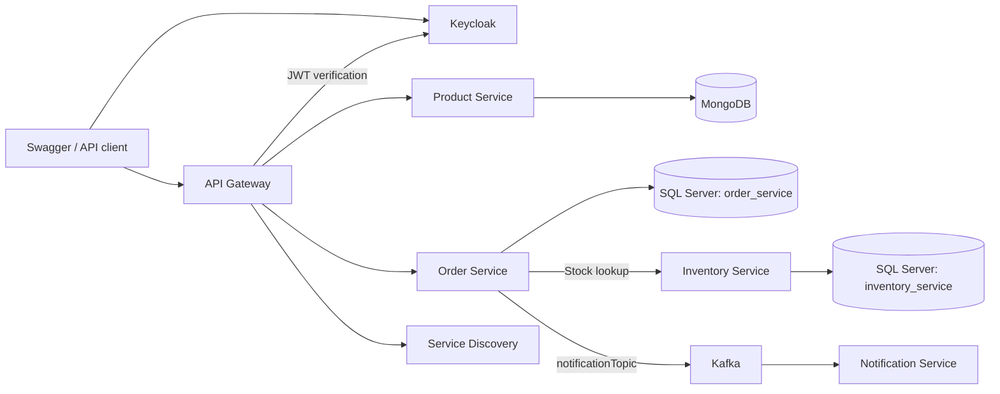

# Microservices E-Commerce Backend

A portfolio backend demonstrating Spring Cloud routing and discovery, a MongoDB
catalog, SQL Server orders and inventory, Kafka messaging, and Keycloak JWT
authorization. This is a learning/demo project, not a production checkout system.

## Interactive API Documentation

Start the stack, then open **[Swagger UI](http://localhost:18089/docs)**.
One page shows **Products**, **Orders**, and **Inventory (Internal)**, plus the
service overview and communication flow. Public product reads work immediately;
protected operations accept a Keycloak token through **Authorize**. Inventory
is reference only and cannot be executed through the gateway documentation.

- [API demo walkthrough and request examples](docs/api-demo.md)
- [Publish the API reference on GitHub Pages for free](docs/github-pages.md)
- [Hosting recommendation and public-demo checklist](docs/hosting.md)
- [Build/startup details](docs/phase-1.md)

The URL above runs on your computer. A public deployment has not been configured.

## Start Locally

Prerequisites: Docker with Compose and enough memory for the full stack.
Java 26 and Maven 3.9+ are needed only for local Maven builds; Docker supplies
its own build tools. The running stack used about 8 GiB during a local idle
measurement; allow additional memory for startup, builds, and the host OS.

```powershell
docker compose config --quiet
docker compose up -d --build
docker compose ps -a
powershell -NoProfile -File scripts/Test-Startup.ps1
powershell -NoProfile -File scripts/Test-ApiDocs.ps1
```

The SQL initialization container should exit with code 0. Other containers are
long-running. Eureka registration can take a short time after startup.
Do not use `docker compose down -v` for routine restarts: it removes database volumes.

## Architecture



## API Surface

These authorization rules apply **through the gateway**.

| Method | Path | Gateway access | Behavior |
| --- | --- | --- | --- |
| GET | `/api/product` | Public | List products |
| GET | `/api/product/{id}` | Public | Read a product |
| POST | `/api/product` | ADMIN | Create a product; empty 201 response |
| POST | `/api/order` | USER or ADMIN | Place order; inspect response body |

Inventory has a separate service-local `GET /api/inventory?skuCode=...` endpoint.
It is not routed through the gateway. No product update/delete, order history,
payment, or stock reservation APIs are implemented.

## Local URLs

| Component | URL |
| --- | --- |
| Gateway Swagger | http://localhost:18089/docs |
| Combined OpenAPI JSON | http://localhost:18089/openapi/all |
| Product OpenAPI JSON via gateway | http://localhost:18089/openapi/products |
| Order OpenAPI JSON via gateway | http://localhost:18089/openapi/orders |
| Inventory Swagger, local/internal development | http://localhost:8084/swagger-ui.html |
| Keycloak | http://localhost:18085 |
| Eureka | http://localhost:8761 |
| Zipkin | http://localhost:9411 |
| Prometheus | http://localhost:9090 |
| Grafana | http://localhost:3000 |

Local realm users are `user/password` (USER) and `admin/password` (USER, ADMIN).
Keycloak administration and Grafana use `admin/admin`. These are intentionally
public local-demo credentials. Never reuse them on an internet-accessible server.

## Technology

Java 26, Spring Boot 4.0.8, Spring Cloud 2025.1.3, Springdoc OpenAPI 3.0.0,
Spring Cloud Gateway WebFlux, Eureka, Keycloak, MongoDB, SQL Server, Kafka,
Resilience4j, Actuator, Micrometer, Zipkin, Prometheus, Grafana, Docker Compose.
Tests use JUnit, Mockito, MockWebServer, and Testcontainers.

## Verification

```powershell
mvn -B clean package -DskipTests
mvn -B -pl Product-service test "-Dtest=ProductServiceTest,ProductControllerTest"
powershell -NoProfile -File scripts/Test-ApiDocs.ps1
```

Packaging skips test execution. The focused Product tests and the API documentation
smoke check are separate from the full suite. Run `mvn -B clean verify` for the
full suite; existing order contract and integration-fixture failures remain.
The GitHub Actions workflow runs that full command; do not assume CI is green.

## Known Limitations

- Direct service ports are published by local Compose and bypass gateway auth.
  Do not deploy this Compose configuration unchanged to the internet.
- Order prices come from requests. Stock checks do not reserve quantities and
  do not correctly reject every unknown SKU.
- The order fallback can return HTTP 201 with a failure message. Timeouts and
  error contracts need further work.
- Kafka publication and database writes are not atomic. Event deserialization,
  dead-letter routing, and idempotency need repair and end-to-end tests.
- Monitoring containers are present, but some scraping and Grafana provisioning
  need repair. Their presence is not proof of working dashboards.
- The local Keycloak realm is reimported on recreation; console changes are not
  persisted by this setup.

These are follow-up engineering tasks, not completed features.

## Portfolio Description

"Built a containerized Java microservices backend with gateway JWT authorization,
Eureka service discovery, MongoDB and SQL Server persistence, Kafka integration,
and aggregated OpenAPI documentation with interactive API examples."

Add a public live-demo link only after deployment and external verification.

